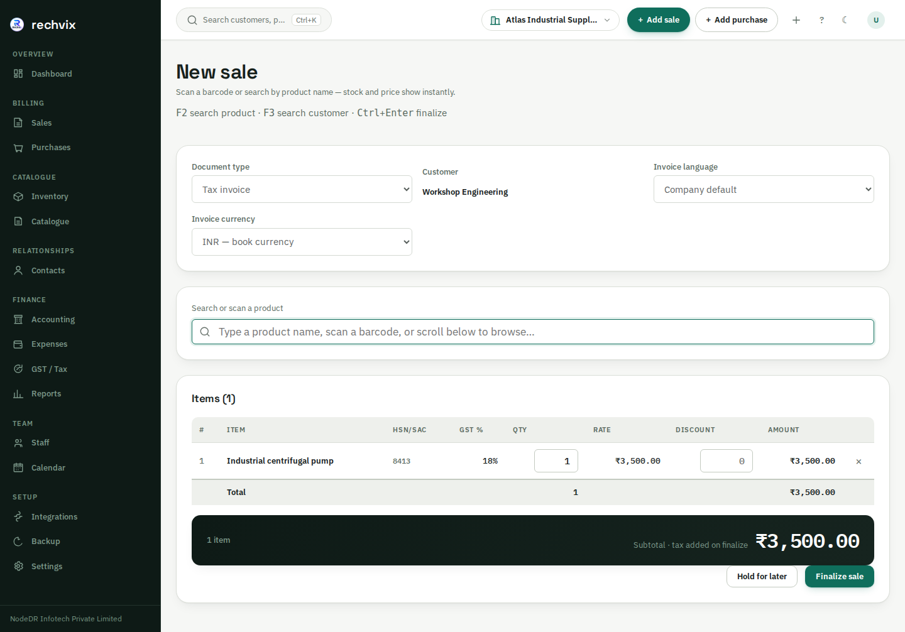
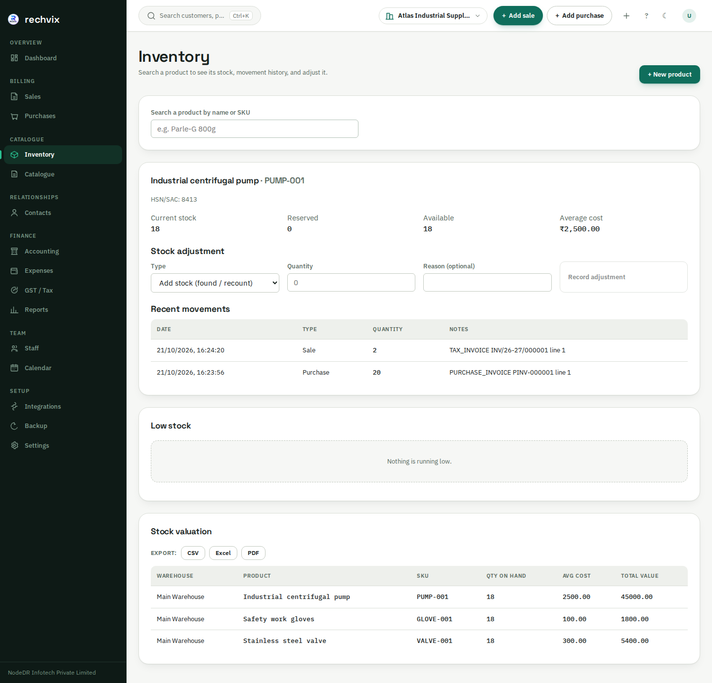
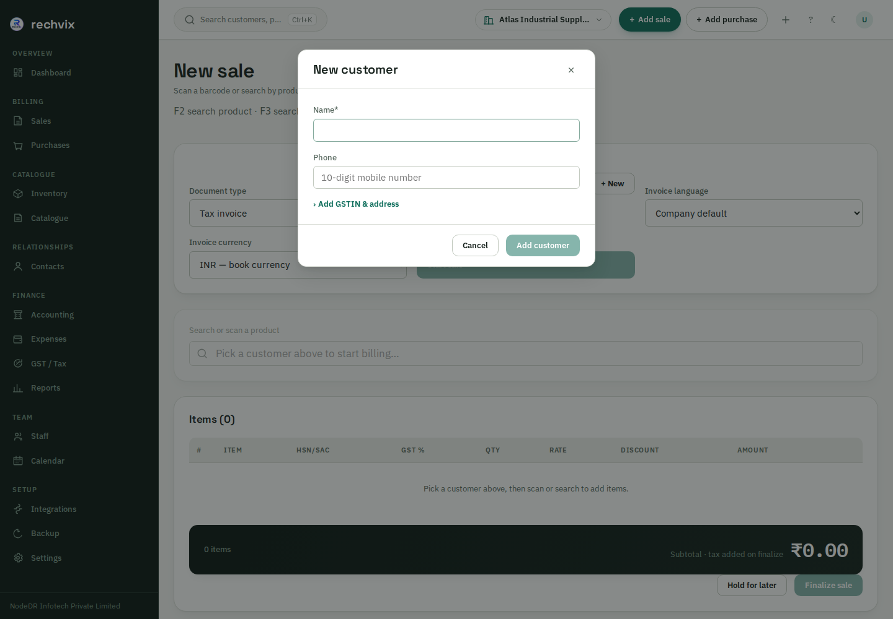
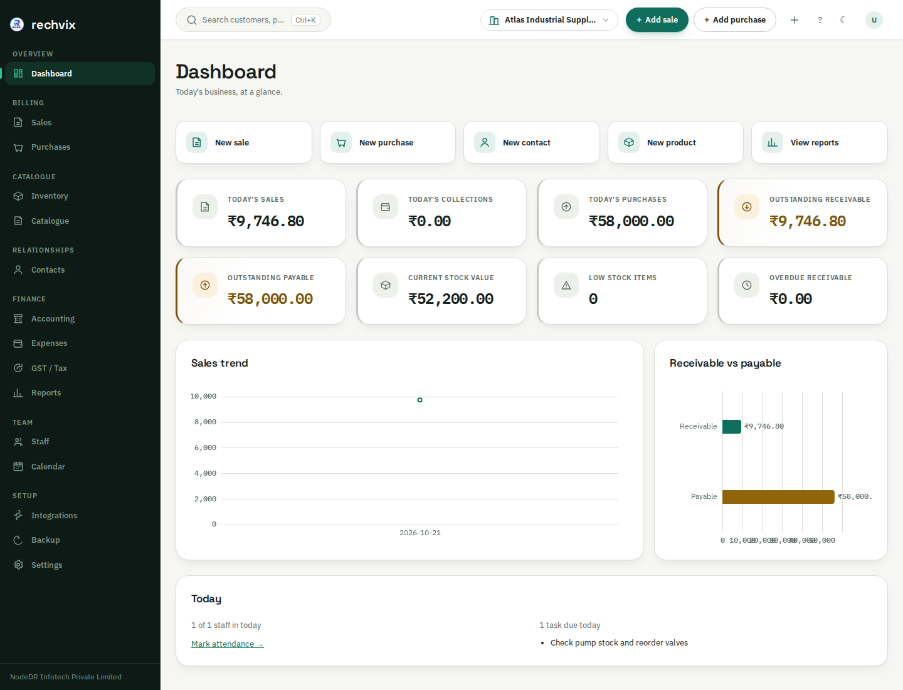

<p align="center">
  
</p>

# Rechvix — Open-source ERP, invoicing, inventory and accounting software

**Rechvix is self-hosted business software for creating invoices, managing stock, recording purchases and payments, and preparing tax records for your accountant.** It brings billing, multi-warehouse inventory and double-entry accounting into one application for distributors, workshops, industrial suppliers and small businesses.

Run it on your own server with Docker Compose or CasaOS/ZimaOS, and use the responsive web app on desktop, tablet or phone. Core business records stay in your PostgreSQL database. Rechvix is licensed under **AGPL-3.0**, with no mandatory subscription for the self-hosted application; hosting and optional external services have their own costs.

[](https://github.com/Raktim94/rechvix/actions/workflows/ci.yml)
[](LICENSE)
[](go.mod)

**[Read the complete tutorial: every page, with 48 screenshots](tutorial.md)** · [Install Rechvix](#install-rechvix) · [Try the hosted app](https://rechvix.nodedr.com/) · [Tax and accountant exports](#tax-calculation-and-accountant-exports) · [Documentation](#documentation)

## What you can do with Rechvix

- **Create invoices in one workspace.** Search existing customers or create one inline, scan/search products, check stock, edit quantities and discounts, hold drafts, and finalize invoices without repeatedly switching pages.
- **Manage products and stock.** Maintain products, variants, SKUs, barcodes, units, selling prices, categories and brands. Review warehouse balances, reservations, valuation, low stock and movement history; record reasoned stock adjustments.
- **Track purchases and payments.** Record supplier purchases, receive stock, manage returns, allocate customer receipts and supplier payments to invoices, and review outstanding balances.
- **Keep connected accounts.** Finalized documents post accounting entries alongside their supported tax and stock effects. Review ledgers, receivables/payables, ageing, trial balance, fiscal periods and expenses with supporting attachments.
- **Print and share documents.** Choose A4, compact and thermal print layouts, invoice branding and language. Hindi invoices support browser printing with an embedded Devanagari font. WhatsApp/PDF sharing controls are available on supported devices and documents.
- **Work across languages and currencies.** Choose from eight interface languages—English, Spanish, French, German, Italian, Portuguese, Dutch and Hindi. Invoice language and currency can be selected separately; foreign-currency invoices use an explicit stored exchange rate for accounting in the company currency.
- **Prepare files for an accountant.** Download company-scoped tax workbooks, source registers, review checks and audit evidence for India, Spain, the UK and the US. Unknown statutory inputs remain visibly unresolved instead of being guessed as zero.
- **Sell and serve.** Recurring invoices, workflow statuses, delivery-note billing, a CRM pipeline, field service (customer equipment, incidents, maintenance plans), electronic signatures, card and PayPal payment links, SEPA direct-debit files, emailed documents with read receipts, overdue reminders, and an online shop with a client area. Each is opt-in; see the [changelog](CHANGELOG.md) for what each does and does not do.
- **Organize the daily workload.** Record staff, attendance and calendar tasks; use global search, keyboard shortcuts, light/dark themes and responsive navigation.
- **Connect and protect your installation.** Use scoped API keys, signed webhooks and a permission-checked read-only MCP interface. Server-managed sessions, Argon2id passwords, TOTP MFA support, audit records and tenant Row-Level Security form the security foundation.

Some document types and administrative capabilities are exposed through APIs rather than equivalent dedicated screens. The [illustrated tutorial](tutorial.md) explains what is available in the current UI; [OpenAPI](api/openapi/openapi.yaml) documents the API surface.

## Screenshots from the running app

These screenshots were captured from the **0.14.24 application on 21 October 2026**, using fictional records and a real local server/database, without mocked API responses. Long pages are shown in full in the tutorial; click an image for detail.

| Invoice and customer workflow | Inventory and reporting |
|---|---|
|  **Single-workspace invoicing** |  **Warehouse inventory and stock history** |
|  **Create a customer without leaving the invoice** |  **Business dashboard** |

**[View all 48 screenshots and the step-by-step tutorial](tutorial.md)**, including purchases, contacts, accounting, expenses, staff, calendar, tax pages for four countries, backup, settings and phone layouts.

## Start here: the complete user tutorial

The root-level **[tutorial.md](tutorial.md)** covers every one of the application's **22 route patterns**, plus the main forms and dialogs.

| You want to… | Open the walkthrough |
|---|---|
| Set up your business or recover access | [Setup, sign-in and password recovery](tutorial.md#1-first-setup-and-signing-in) |
| Configure tax identity, language, branding or team access | [Business settings](tutorial.md#3-settings-prepare-your-business) |
| Add products, selling prices and customers | [Catalogue](tutorial.md#4-catalogue-products-prices-and-imports) and [contacts](tutorial.md#5-contacts-customers-and-suppliers) |
| Create an invoice and get paid | [Invoice building](tutorial.md#7-sales-build-and-finalize-an-invoice) and [printing, payments and returns](tutorial.md#8-invoice-details-print-payment-return-and-cancellation) |
| Receive stock and pay suppliers | [Inventory](tutorial.md#6-inventory-stock-and-movement-history) and [purchases](tutorial.md#9-purchases-stock-received-and-supplier-payments) |
| Hand tax records to your CA/accountant | [Country-specific tax preparation and downloads](tutorial.md#12-tax-and-files-for-your-accountant) |
| Manage staff, tasks and backups | [Staff and calendar](tutorial.md#14-staff-and-calendar) and [backup/restore](tutorial.md#16-backup-and-restore) |
| Use Rechvix on a phone | [Mobile navigation and billing](tutorial.md#17-using-a-phone) |

## Tax calculation and accountant exports

Rechvix separates **recorded tax calculation**, **accountant preparation** and **government submission**. It does not file tax returns. Accountant exports require no government API credentials, but the accountant still needs to verify completeness, deduction eligibility, adjustments and the appropriate filing workflow.

| Country | Supported preparation | What still needs attention |
|---|---|---|
| **India** | GST components, HSN/place-of-supply calculations, supported purchase input-tax recording, GSTR-1/GSTR-3B workpapers and eligible offline-tool CSVs | Current utility validation, omitted/unsupported statutory sections, GSTR-2B and ITC eligibility. Any export ERROR withholds all native CSVs together. Live e-Invoice/e-Way Bill operation requires the appropriate real setup; mock/sandbox outputs are not live issuance. |
| **Spain** | IVA and recargo calculation; ordinary rate buckets and credit-note corrections; Modelo 303 workpapers, source registers and purchase-tax candidates | Accountant allocation of deductible tax, prorrata, acquisitions/imports, carry-forwards and settlement. No AEAT upload file, SII or RRSIF/VERI*FACTU implementation. |
| **United Kingdom** | VAT calculations, recorded input-tax candidates, sales/purchase registers and a nine-box accountant worksheet | Accountant adjustments and scheme/NI handling. The CA uses appropriate Making Tax Digital software and digital links for filing. Rechvix does not submit MTD returns. |
| **United States** | Recorded state base sales tax and separate state schedules, with taxable/exempt/not-collected sales | Local/district taxes, nexus, use tax, marketplace rules, product taxability and state-specific return mapping. Base-rate schedules alone are not complete returns. |

The country dispatcher also supports configured VAT calculations for EU member states; this is not a claim that every country's invoicing, reporting or filing obligations are implemented. The verified accountant-workpaper mapping year is **2026**. These exports do not cover every corporate, payroll or personal income tax.

The ZIP package includes an XLSX workbook, CSV registers, exact-decimal source JSON, review checklist, README and SHA-256 manifest. Blank statutory fields stay blank for accountant input. Read the [accountant export contract](docs/accountant-exports.md) and [tax-regime limitations](docs/tax-regimes.md) before relying on a country workflow.

## Install Rechvix

### Docker Compose on your own server

With Docker installed, inspect [install.sh](install.sh), then run:

```bash
curl -fsSL https://raw.githubusercontent.com/Raktim94/rechvix/main/install.sh | bash
```

The installer clones the repository, generates the Compose secrets and starts PostgreSQL, migrations, the app and the worker. Open the URL it prints and complete `/setup`. Review TLS, secure cookies, backups and bootstrap settings before exposing an installation publicly. The [deployment guide](docs/operations/deployment.md) explains operator responsibilities and manual installation.

For a machine that also needs Docker/git setup, inspect and use the [Linux/macOS quickstart](scripts/quickstart.sh) or [Windows PowerShell quickstart](scripts/quickstart.ps1). The Windows quickstart uses WSL2 for the server stack.

### CasaOS and ZimaOS

Use the platform's custom Compose installation workflow with:

```text
https://raw.githubusercontent.com/Raktim94/rechvix/main/casaos/docker-compose.yml
```

The current manifest pins **0.14.24** for the server, migration and worker services, with images published for **amd64 and arm64**. It generates database/encryption secrets on first boot. Open `http://<your-server>:8090`, then complete setup.

Back up both `/DATA/AppData/rechvix/postgres` and `/DATA/AppData/rechvix/secrets`. Keep the secrets when upgrading; removing the application data can destroy records or make encrypted data unrecoverable. Consult the [CasaOS manifest](casaos/docker-compose.yml) and [deployment guide](docs/operations/deployment.md) for the current configuration.

### Desktop, tablet and mobile access

The responsive web application runs in a browser against your Rechvix server. A **Tauri 2 desktop shell** is included under [`apps/desktop`](apps/desktop), with a Windows MSIX build/package/test workflow. The desktop package bundles the Go server and a local PostgreSQL database, starting them on launch so the packaged app can operate locally without a separate hosted server. Review [desktop documentation](apps/desktop/README.md) for installation/build status and platform requirements.

## Architecture and technology

Rechvix is a **Go modular monolith with PostgreSQL**, designed to keep related invoice, tax, stock and accounting changes in one database transaction.

| Area | Implementation |
|---|---|
| Backend | Go 1.27, `net/http`, chi router, pgx |
| Database | PostgreSQL 18, exact `NUMERIC` money/rates, UUIDv7, tenant RLS |
| Frontend | React 19, TypeScript, Vite, TanStack Query/Router, React Hook Form, Zod, ECharts |
| Money and stock | Decimal calculations; append-only stock movements and recorded cost data |
| Accounting | Double-entry journals, database posting constraints and immutable posted records |
| Authentication | Server-side sessions, Argon2id, TOTP MFA support, scoped authorization |
| Integrations | Transactional outbox/worker, API keys, signed webhooks, read-only MCP tools |
| Distribution | Docker Compose, GHCR server/worker images, CasaOS/ZimaOS, Tauri desktop shell |
| Verification | Go unit/integration tests, static/security checks, frontend build/tests, Playwright accessibility and keyboard checks, container builds |

Production safety depends on deployment configuration and operating practices as well as application controls. A passing test suite is not certification of tax compliance or proof that every security/performance risk has been eliminated. See the [architecture](docs/architecture.md), [security reporting instructions](CONTRIBUTING.md#reporting-security-issues) and [feature audit](docs/feature-audit.md).

```text
apps/             server, worker, web, desktop and MCP entrypoints
internal/modules/ business domains: sales, purchases, inventory, tax, accounting…
internal/platform/ shared database, auth, permissions, money and infrastructure
api/openapi/      REST API specification
migrations/       versioned SQL migrations
deploy/           Docker and Compose configuration
casaos/           CasaOS/ZimaOS manifest and assets
tests/            integration and browser tests
docs/             architecture, operations, tax scope and screenshot inventory
tutorial.md       illustrated guide to every application page
```

## Development and testing

Use the Go toolchain pinned by [go.mod](go.mod), PostgreSQL 18 and a supported Node.js environment for the frontend. Follow [CONTRIBUTING.md](CONTRIBUTING.md) and the [deployment guide](docs/operations/deployment.md) for configuration.

```bash
git clone https://github.com/Raktim94/rechvix.git
cd rechvix
go build ./...
go test ./...
```

Configure a local database before starting the server. Apply migrations with a schema-owning role and run ordinary traffic with a separate non-owning runtime role; using the table owner for runtime traffic can bypass RLS. Start the configured backend with `go run ./apps/server` and the web frontend with:

```bash
npm --prefix apps/web ci
npm --prefix apps/web run dev
```

Additional checks:

```bash
go test -tags=integration ./...  # requires the documented test database/Docker setup
npm --prefix apps/web run lint
npm --prefix apps/web test
npm --prefix apps/web run i18n:check
npm --prefix apps/web run build
```

Browser tests live under [`tests/e2e`](tests/e2e). CI runs the repository's configured checks on pushes and pull requests; the badge above links to current results.

## Frequently asked questions

### Is Rechvix free and open source?

The self-hosted application is available under the [GNU Affero General Public License v3](LICENSE). You operate your own infrastructure. Review the license's obligations when modifying or distributing it or providing a modified network service; optional providers and hosting are separate.

### Can I use it for an industrial supplier or warehouse business?

Rechvix supports the billing, products, stock, purchasing, payments and accounting workflows used by these businesses. It is not a claim of a complete manufacturing/MRP system: production planning, bills of materials and other industry-specific requirements should be evaluated separately.

### Can I create a customer while making an invoice?

Yes. The billing screen lets you search previous customers or create one inline, including available tax/address details. See the [invoice tutorial](tutorial.md#7-sales-build-and-finalize-an-invoice).

### Can my accountant use the tax files without connecting Rechvix to the government?

Yes. The supported accountant packages are downloaded locally without tax-authority API credentials. Your accountant reviews and completes them and uses the appropriate filing tools. This does not remove separate invoicing obligations or make every file directly uploadable to every portal.

### Does Rechvix work offline?

The self-hosted web client needs a connection to your own Rechvix server; it does not provide offline browser editing or automatic synchronization. The packaged desktop app bundles its own server and PostgreSQL for local operation. Government portals, external sharing and configured external integrations still need connectivity.

### Where is the user manual?

Start with **[tutorial.md: every page and 48 screenshots](tutorial.md)**. The older [PDF user manual](docs/Rechvix-User-Manual.pdf) is also available, but may not show the latest features and screenshots.

## Documentation

- [Complete illustrated user tutorial](tutorial.md) — setup, every page, daily workflows and troubleshooting.
- [Screenshot inventory](docs/assets/tutorial/README.md) — capture scope, image links and metadata.
- [Accountant export scope](docs/accountant-exports.md) — country workpapers, supported native files and review requirements.
- [Tax regimes and limitations](docs/tax-regimes.md) — country-specific calculations and compliance gaps.
- [Architecture](docs/architecture.md) and [database design](docs/database.md) — business rules, transaction boundaries and schema.
- [REST API guide](docs/api.md) and [OpenAPI specification](api/openapi/openapi.yaml).
- [Deployment and recovery](docs/operations/deployment.md) — installation, configuration, backups and operational controls.
- [Feature audit](docs/feature-audit.md), [implementation checklist](docs/TODO.md) and [changelog](CHANGELOG.md).
- [Contributing](CONTRIBUTING.md) and [architecture decision records](docs/adr).

## Project and license

Built by **[NodeDR Infotech Private Limited](https://www.nodedr.com/)**. Maintainer: **[Raktim Ranjit](https://www.raktimranjit.com/)**. [Project case study](https://www.raktimranjit.com/projects/rechvix) · [Issues and bug reports](https://github.com/Raktim94/rechvix/issues) · [AGPL-3.0 license](LICENSE).
