# Rechvix: complete illustrated user tutorial

This guide walks through every page in Rechvix, from first setup to invoicing, stock, payments and accountant handoff. Screenshots were captured from the actual locally running app on **21 October 2026**, using the **0.14.24 codebase (`33cf146`)** and fictional businesses. No production customer records or API mocks were used. Amounts, names, tax identifiers and addresses shown are demonstration data, not valid registrations to copy into your business.

Desktop captures include the complete contents of long pages. Click an image to inspect it at full size. The mobile examples show the normal phone viewport. Some controls appear only after selecting a document, opening a form, or choosing the relevant company.

## Contents

1. [First setup and signing in](#1-first-setup-and-signing-in)
2. [Navigation and dashboard](#2-navigation-and-dashboard)
3. [Settings: prepare your business](#3-settings-prepare-your-business)
4. [Catalogue: products, prices and imports](#4-catalogue-products-prices-and-imports)
5. [Contacts: customers and suppliers](#5-contacts-customers-and-suppliers)
6. [Inventory: stock and movement history](#6-inventory-stock-and-movement-history)
7. [Sales: build and finalize an invoice](#7-sales-build-and-finalize-an-invoice)
8. [Invoice details: print, payment, return and cancellation](#8-invoice-details-print-payment-return-and-cancellation)
9. [Purchases: stock received and supplier payments](#9-purchases-stock-received-and-supplier-payments)
10. [Expenses](#10-expenses)
11. [Accounting and fiscal periods](#11-accounting-and-fiscal-periods)
12. [Tax and files for your accountant](#12-tax-and-files-for-your-accountant)
13. [Reports](#13-reports)
14. [Staff and calendar](#14-staff-and-calendar)
15. [Integrations](#15-integrations)
16. [Backup and restore](#16-backup-and-restore)
17. [Using a phone](#17-using-a-phone)
18. [Daily checklist and troubleshooting](#18-daily-checklist-and-troubleshooting)
19. [Page and screenshot coverage](#19-page-and-screenshot-coverage)

## 1. First setup and signing in

### Set up a new installation — `/setup`

Open **Set up your business** from the sign-in page on a new installation.

1. Enter the business name and the legal entity name that should appear on invoices.
2. Choose the actual **country**, **book currency** and **timezone**. Check these even when the browser supplies defaults. The country controls the tax regime; the book currency controls accounting. Choosing another currency on an invoice later does not change your accounting currency.
3. For India, supply the business GST state and, when registered, its GSTIN.
4. Name the first branch and warehouse.
5. Enter the owner's name, email and a password of at least 12 characters; confirm the password.
6. Select **Create business and continue**, then sign in.

Use the setup screen for a fresh installation. Existing users should sign in instead. The administrator should disable public bootstrap after setup using the deployment configuration.

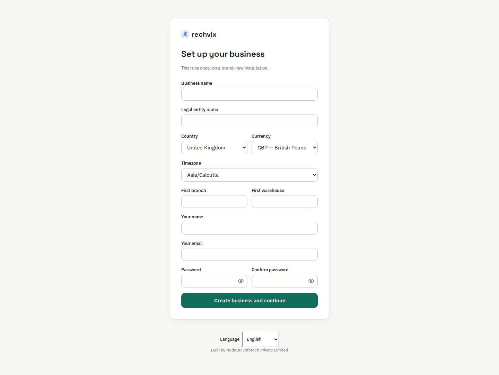

### Sign in — `/login`

Enter your work email and password, then select **Sign in**. Use the eye button to check a mistyped password. The language picker changes interface language. Protect your account and avoid sharing the owner's login with staff.

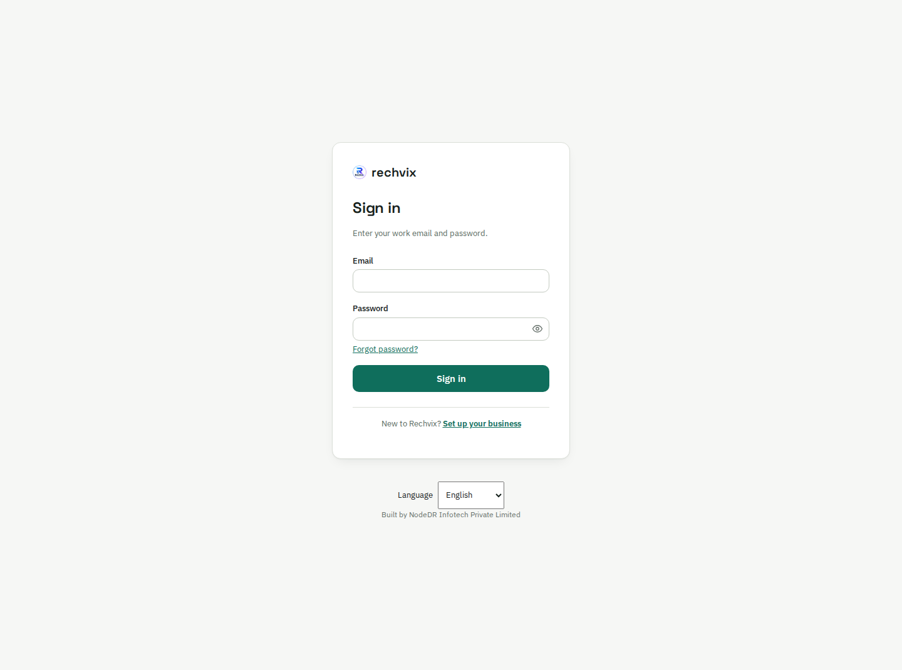

### Recover access — `/forgot-password` and `/reset-password`

Select **Forgot password?**, enter your email and request a reset link. Open the link delivered through your installation's configured recovery workflow. Its token identifies the reset request; opening `/reset-password` alone cannot reset an account. Set and confirm the new password from a valid link, then sign in again. If no message arrives, ask the installation operator to check email delivery rather than repeatedly creating accounts.

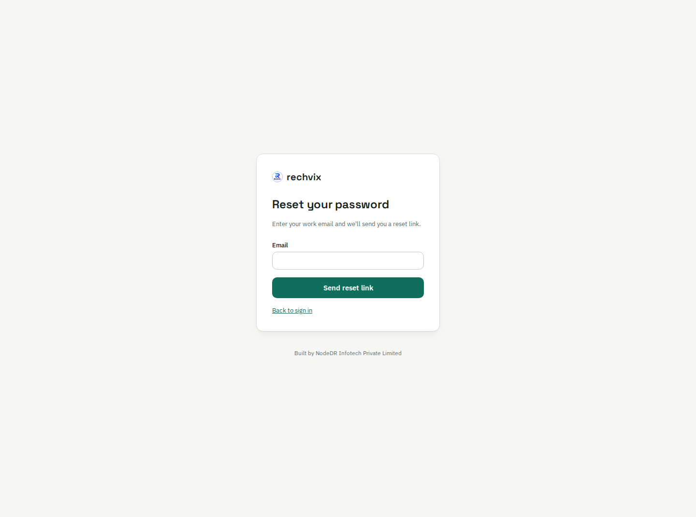

The screenshot below deliberately shows the missing-token state, explaining why a direct visit cannot complete a reset.

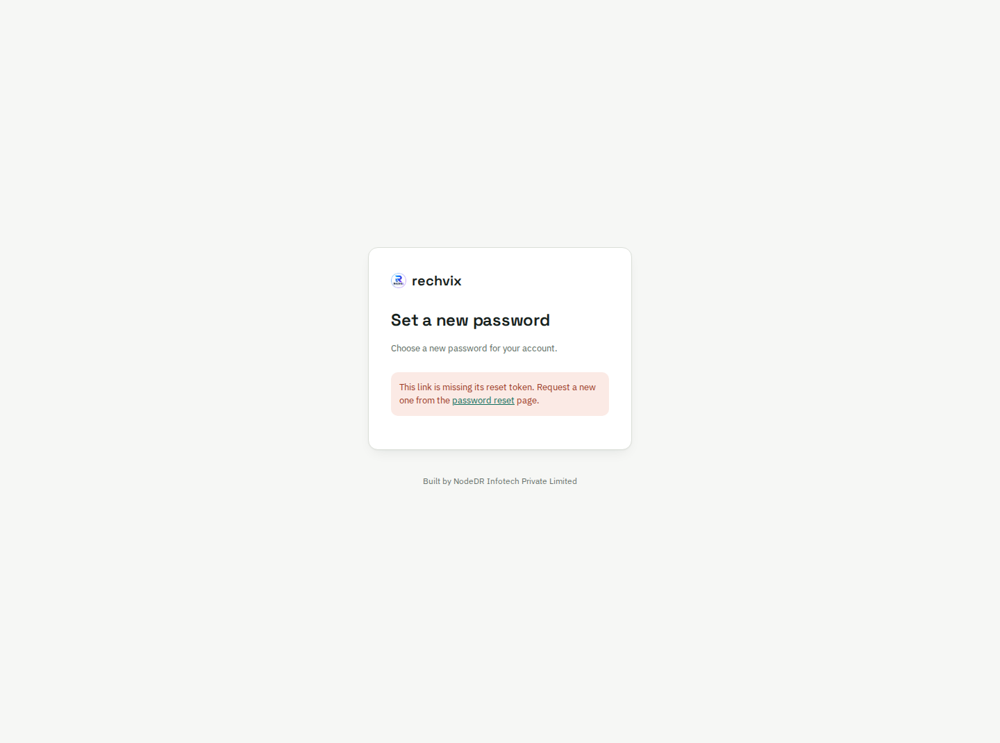

## 2. Navigation and dashboard

### Dashboard — `/`

The dashboard summarizes today's sales, collections and purchases, outstanding receivables/payables, stock value, low-stock items and business trends. **Sales** and **collections** are different: an invoice can increase sales before the customer pays it.

Use **New sale**, **New purchase**, **New contact**, **New product** and **View reports** to begin common tasks. A new installation initially has empty or zero-valued panels; transactions populate them.

The desktop sidebar opens each main page. The top bar contains search, the company switcher, sale/purchase shortcuts, additional creation shortcuts, keyboard help, theme and account controls. Check the selected company before creating a document or downloading a tax package. Some accounting views are organisation-wide; do not assume every table is restricted by the company switcher.

Use **Ctrl+K** for global search, or open the search control. On the invoice screen, **F2** focuses product search, **F3** focuses customer search and **Ctrl+Enter** attempts finalization. Follow validation messages before retrying.

## 3. Settings: prepare your business

### Settings — `/settings`

Start here after setup. Review the business, selected legal entity, branch, warehouse and currency. Update the GST state/GSTIN for India or the relevant tax identifier outside India. For the US, review configured collection states.

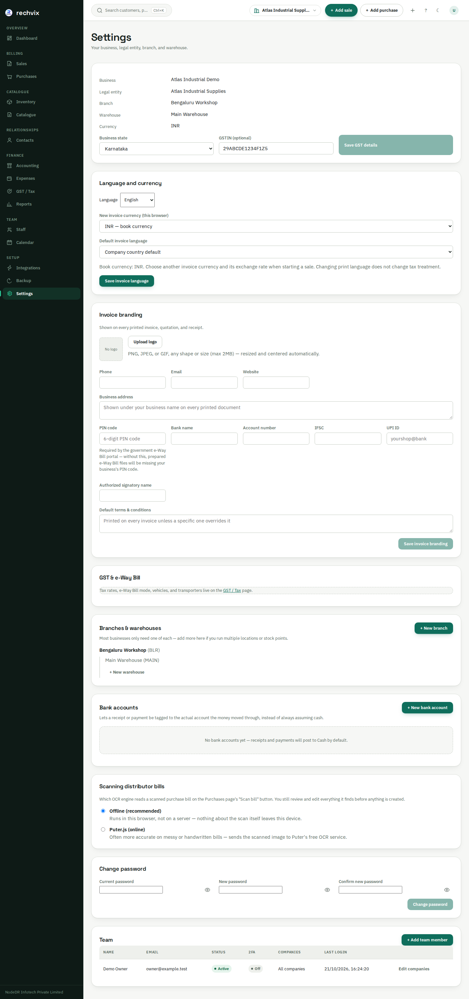

### Language, invoice currency and branding

In **Language and currency**, choose interface language, this browser's preferred new-invoice currency and the company's default invoice language. Save the company invoice-language choice with **Save invoice language**. The invoice screen can override language and currency for a particular document. Foreign-currency invoices require an explicit rate expressed as **company-currency units per one invoice-currency unit**. The app does not obtain a market rate automatically.

In **Invoice branding**, enter contact details, address, bank/payment information, signatory and default terms. Add the logo if needed, then save. Check the resulting invoice printout. Printing in another language changes labels; it does not translate your manually entered product names or notes.

### Branches, warehouses and bank accounts

Use **+ New branch**, give it a code and name, and save it under the correct legal entity. Add warehouses under the correct branch. Confirm the location used by sales and purchases before recording stock.

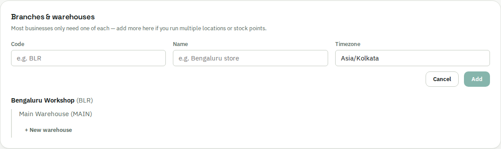

Use **+ New bank account**, enter its name and relevant details, and choose the appropriate account kind. Saved accounts can be selected when recording payments. Enter real bank data only in your own secured installation.

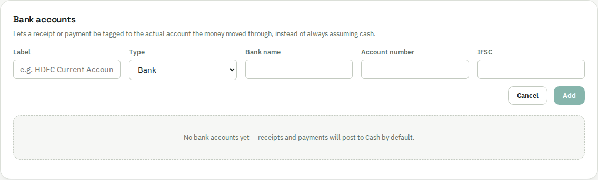

### Team and password

Under **Team**, choose **+ Add team member**, enter the person's name, email and initial password, and review company access. Company access restricts which legal entities they can work with; it should not be treated as a complete fine-grained cashier/accountant role system. Review actual granted permissions with the operator.

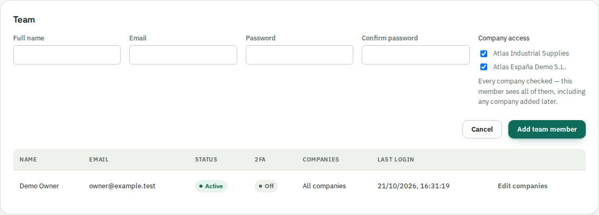

**Change password** updates your own account. **Scanning distributor bills** controls the available bill-import settings; review scans before committing products or purchases.

## 4. Catalogue: products, prices and imports

### Product list — `/catalogue`

Search existing products before adding another. The table shows product identity, HSN/SAC or country tax category, selling price, category, brand and active status. A product must have a sellable variant/SKU; stock and document lines reference that variant.

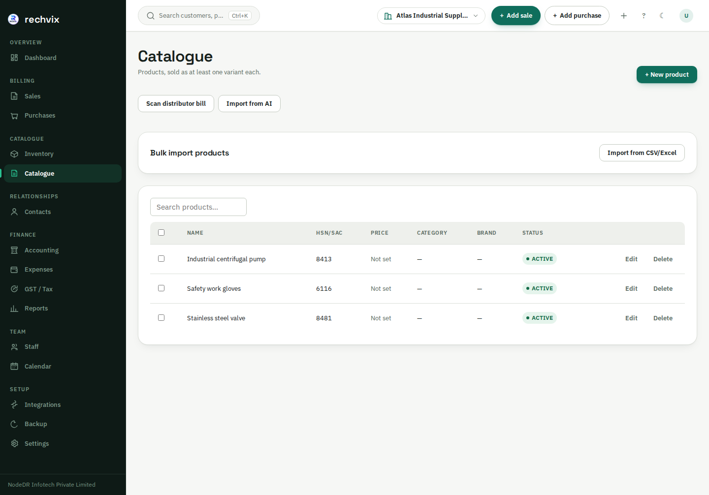

### Add or edit a product

1. Select **+ New product**.
2. Enter a clear product name and choose its base unit. Add a unit from the form if required.
3. For India, enter the correct HSN/SAC and GST rate. Outside India, choose a verified country tax category; an Indian HSN is not a substitute for that category.
4. Set a selling price if the item should have a default price at the billing counter. An unset price can produce a zero-priced invoice line; check it before finalizing.
5. Choose category and brand if useful, then save.
6. Search the product again to confirm it appears.

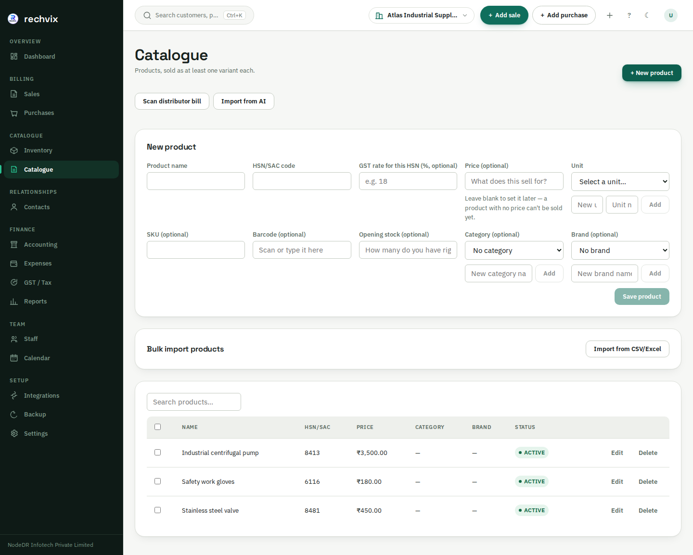

Use **Edit** to change supported product fields and price. The edit form also provides stock adjustment controls. Use a reason when correcting a count. Deleting an item with transaction history may deactivate it to preserve records; check the resulting status instead of assuming its history disappeared.

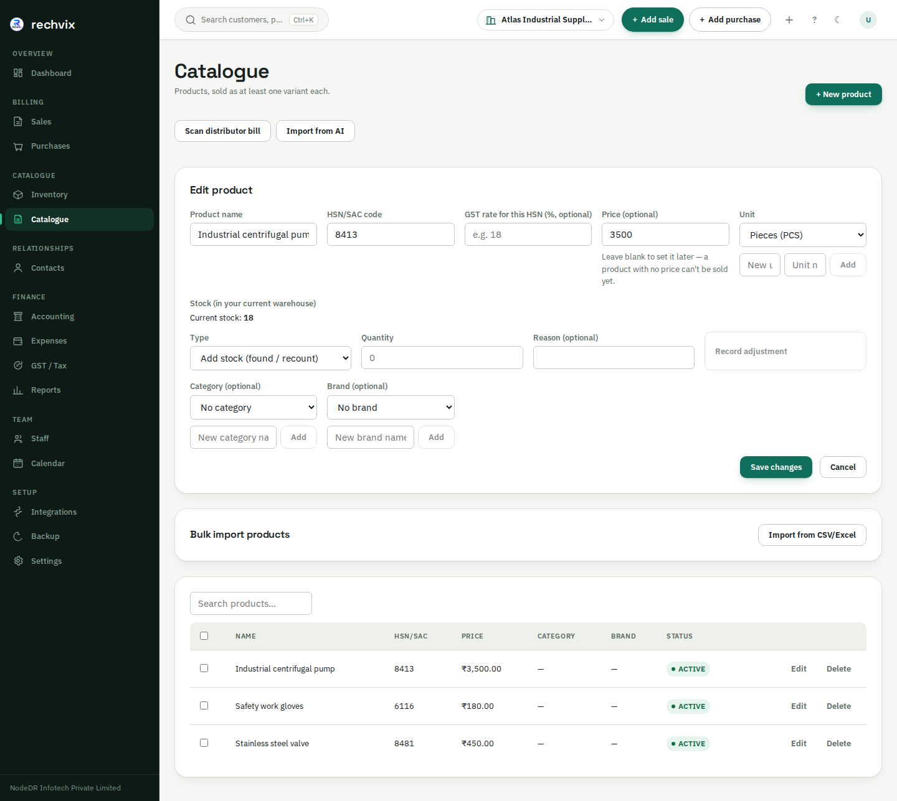

### Bulk imports and distributor bills

**Import from CSV/Excel** opens the shared import workflow. Follow its expected headers/template, select the file, run **Preview**, correct rejected rows, then import once. Verify counts and a few records afterward. Product imports can depend on warehouse and unit details, so review those before committing.

**Scan distributor bill** and **Import from AI** provide assisted entry. Check supplier identity, product matching, unit/pack quantity, price, HSN and tax against the source bill. A successful scan is not proof that the purchase is correct or finalized.

## 5. Contacts: customers and suppliers

### Contacts — `/contacts`

Search by name or phone and filter by customer/supplier type. Select **+ New contact**, choose Customer, Supplier or Both, and enter the name and available contact details. For India, the phone field expects the local 10-digit format. Enter payment/credit terms deliberately.

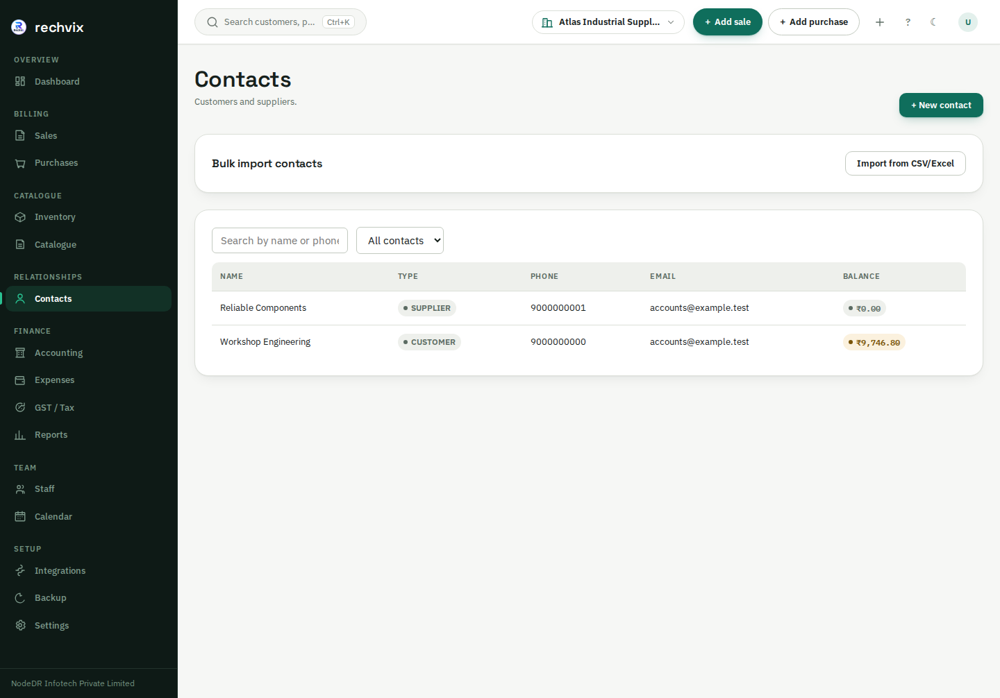

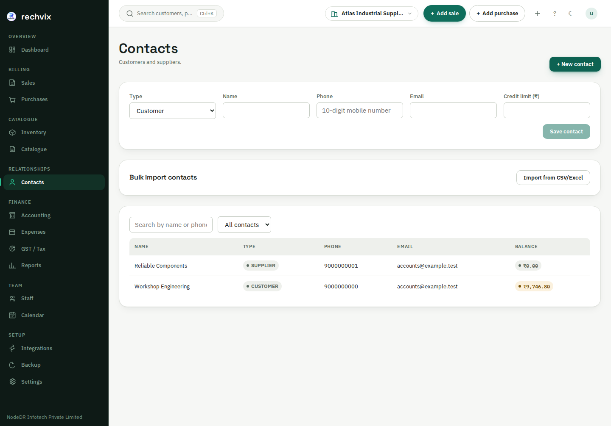

Bulk import is available through **Import from CSV/Excel**. Preview before importing, and avoid creating duplicate phone/customer records.

### Contact details — `/contacts/:id`

Open a contact to see its ledger and balance, record an on-account payment, manage tax registrations and add billing/shipping addresses. Choose the correct country and registration type. Address and tax information affect tax treatment and printed invoices.

The contact ledger shows financial movements and ageing. A payment entered here can be an on-account receipt/payment; use the invoice's payment panel when you need to associate it with a particular invoice.

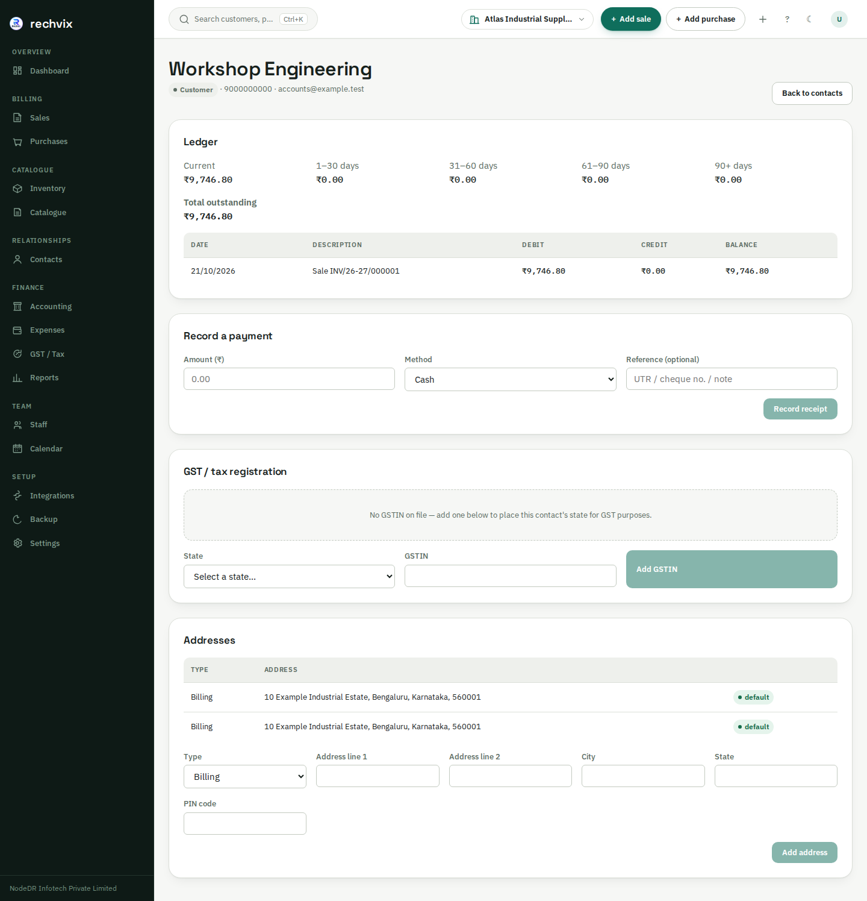

## 6. Inventory: stock and movement history

### Inventory — `/inventory`

Search a product by name or SKU, then select its result. The stock card shows on-hand, reserved and available quantities, average cost and recent movements for the selected warehouse. The lower panels show low stock and stock valuation.

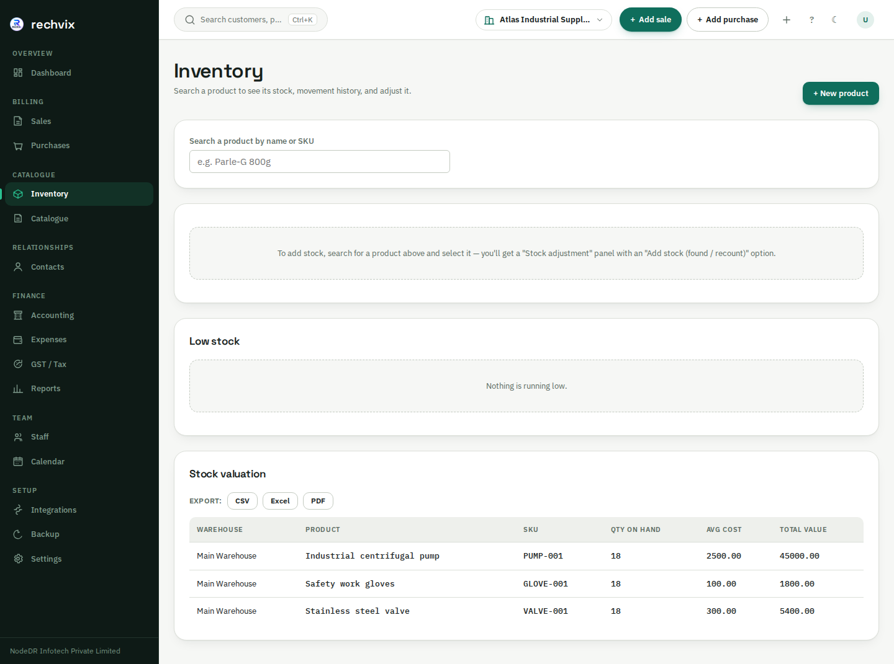

To correct a physical count, select a stock-adjustment type, enter the quantity required by that action and a reason, then record it. Check the new movement and balance. Use purchases to record stock received from suppliers and returns to record returned goods; stock adjustments are for corrections and the supported adjustment reasons.

The example purchase brought in 20 pumps and the finalized sale removed 2, leaving 18. Stock is maintained through recorded movements; it is not simply a number to overwrite.

## 7. Sales: build and finalize an invoice

### Sales list — `/sales`

Use search, document-type/status filters and dates to locate quotations, orders and invoices. Open a document number to see details. A draft can be continued; a finalized document follows the supported return/cancellation workflow. **+ New sale** opens the billing workspace.

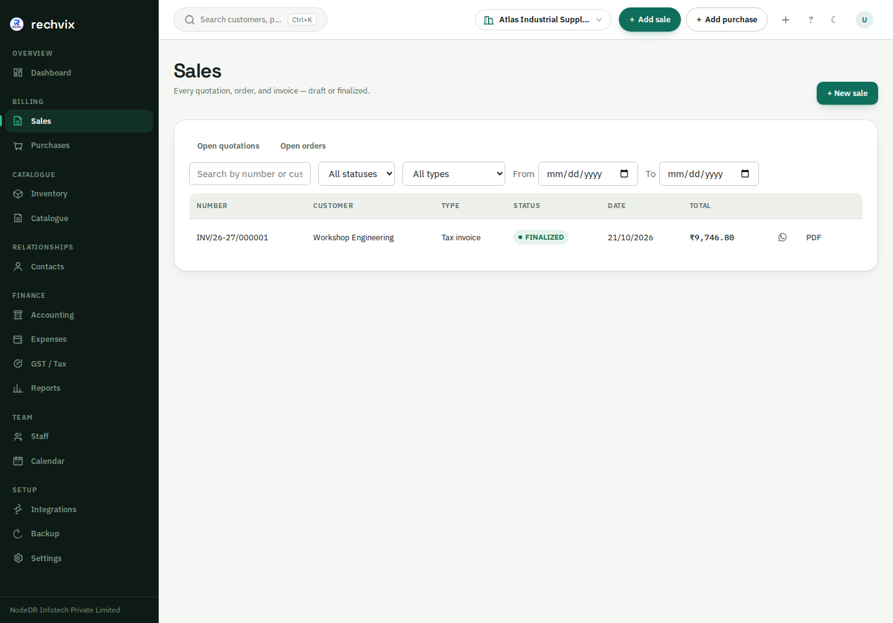

### New sale — `/sales/new`

1. Check the company, branch and warehouse context.
2. Choose the document type, such as Tax invoice, POS invoice, Quotation or Sales order.
3. Search for an existing customer by name or phone and select the result. For retail sales, use **Walk-in / Cash sale** when appropriate.
4. Set invoice language and currency. If foreign currency is selected, enter and verify the exchange rate.
5. Select **Start sale** when shown.
6. Search or scan a product and use **Add**. Review available stock, quantity, rate and discount. Set a missing default selling price in Catalogue before using the item for normal billing.
7. Add the remaining products in the same workspace. Check the subtotal and the applicable tax/pricing mode.
8. Use **Hold for later** to leave a draft, or **Finalize sale** when the document is correct.

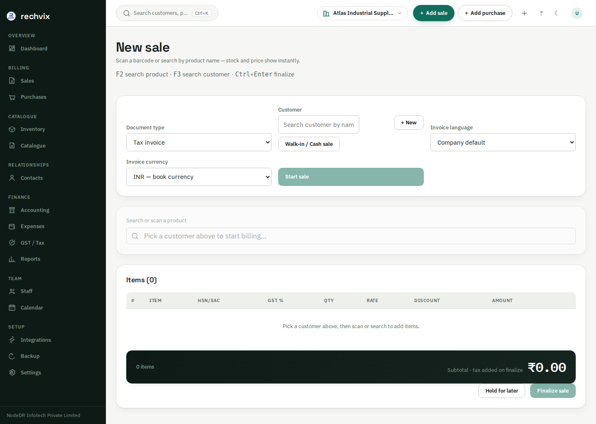

### Create a customer without leaving the invoice

Use **+ New** next to Customer, or the **+ New customer** result beneath a search. Enter the name and phone. Expand **Add GSTIN & address** if needed, enter accurate registration/address details, then select **Add customer**. The new record becomes available in the current invoice; you do not need to navigate to Contacts and rebuild the invoice.

Finalization saves the document's tax calculation and creates the relevant accounting/stock effects. It is not the same as saving an editable draft. If a rate, stock or registration check fails, correct the stated issue and retry; do not create duplicate invoices to bypass it.

## 8. Invoice details: print, payment, return and cancellation

### Finalized invoice — `/sales/:id`

Review the number, status, customer, issue date, lines and grand total. India also shows e-Way Bill and e-Invoice status. The payment panel shows invoice total, paid amount and outstanding amount separately.

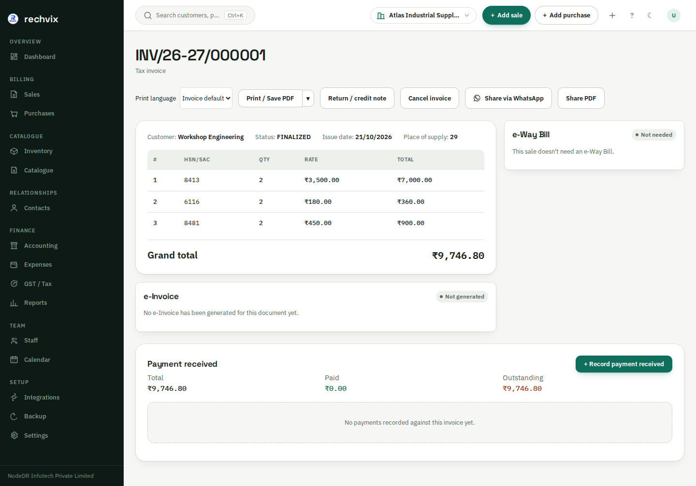

### Print or save a PDF

Choose **Print language** if this copy needs another language, then **Print / Save PDF**. Use the arrow beside it to choose A4, compact, thermal receipt or quotation layouts, and the available design themes. Check that the selected layout is suitable for the document type; a quotation printout is not a replacement for a tax invoice.

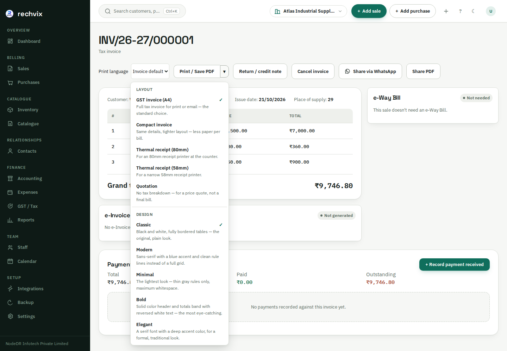

For Hindi, the print view renders Devanagari labels in browser-printable HTML. Use the browser's Print dialog and choose the printer or **Save as PDF**. Check page size, margins and preview. Changing print-copy language does not change the saved invoice amounts or currency.

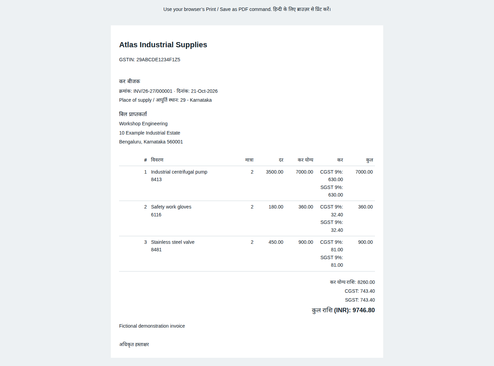

**Share via WhatsApp** opens a customer-sharing workflow when phone details are present. **Share PDF** uses the available browser/device sharing workflow. Review the recipient before sending. Screenshots were captured without sending any customer messages.

### Receive a payment

Select **+ Record payment received**. Choose full amount, a supported percentage or a custom amount; choose the method, bank/account if applicable and reference. Save once. Verify that paid and outstanding amounts update. Do not record the same receipt again from the contact page.

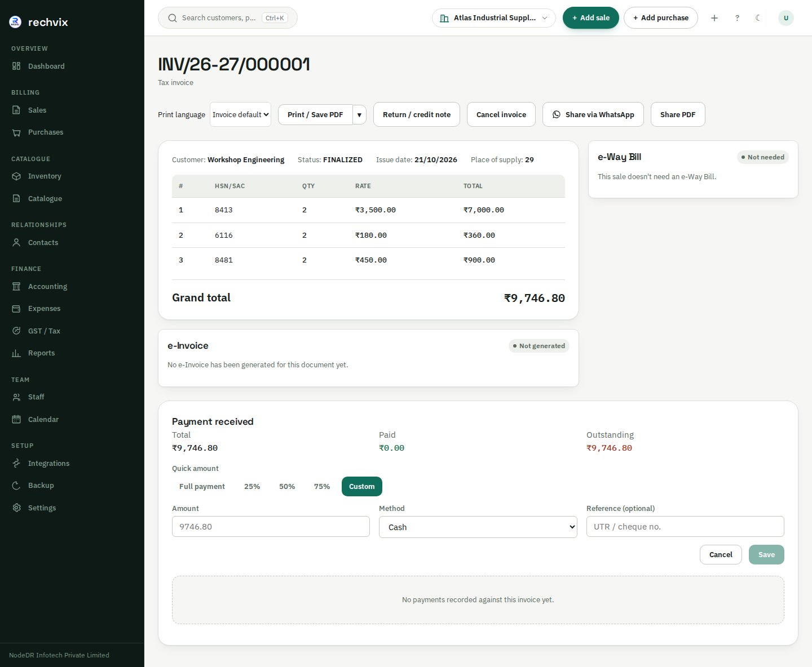

### Return goods or issue a credit note

Open **Return / credit note**. Choose **Sales return** when goods physically come back and stock should increase, or **Credit note** for a financial adjustment without stock movement. Enter only the quantities being adjusted and review the resulting amounts before creating it. The current dialog creates and finalizes the adjustment, so treat its confirmation as a posting action.

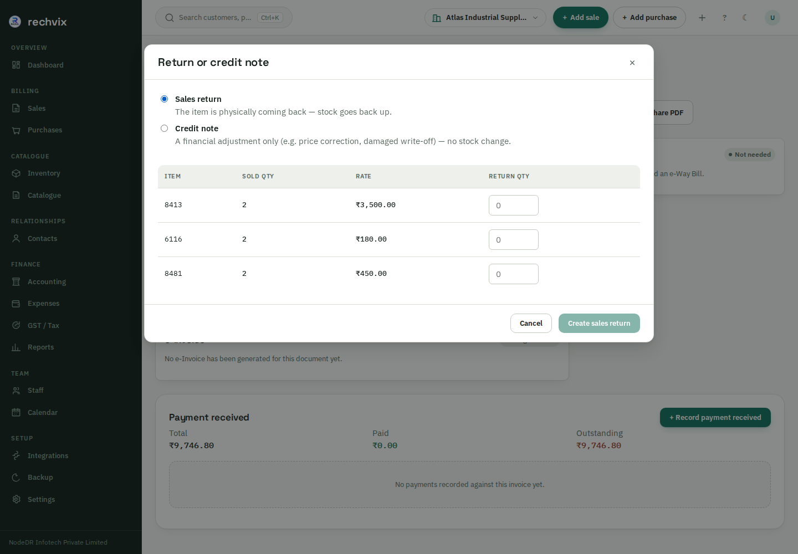

Use **Cancel invoice** only for a genuine cancellation. Read its reason/confirmation requirements. Where government documents are involved, local cancellation and government cancellation are separate concerns; follow the displayed status and your accountant's instructions.

## 9. Purchases: stock received and supplier payments

### Purchases — `/purchases`

Search by number or supplier and filter status/date. Open a purchase number to inspect it. **Scan bill** and **Import from AI** assist entry; they still require human review.

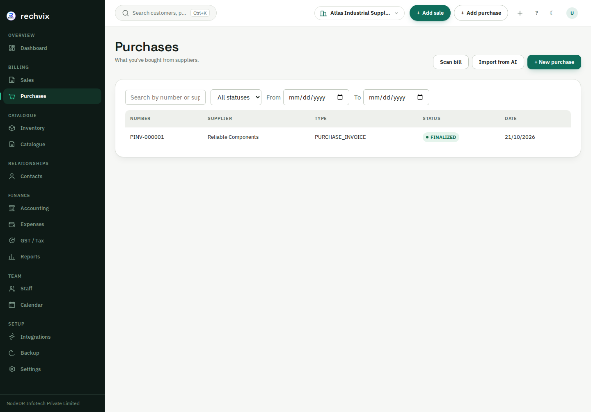

### Record a purchase

1. Select **+ New purchase**.
2. Search for the supplier, select it, or use the inline new-supplier option.
3. Select **Start purchase**.
4. Search products, enter quantity and cost and add the lines.
5. Compare the lines with the supplier invoice, including units, taxes and references.
6. Finalize only when the receipt/invoice is correct. Verify the new stock movement and supplier payable.

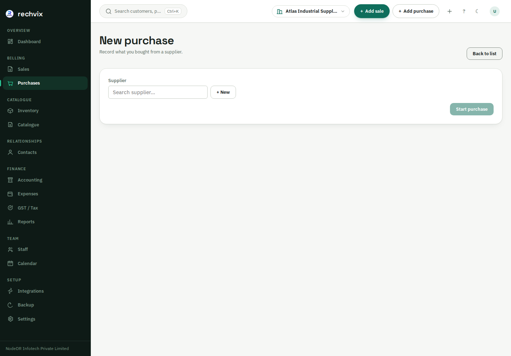

A purchase opens in the same `/purchases` page rather than a separate detail URL. The detail screen may retain the **New purchase** heading even when the selected document is finalized; use the status badge to determine whether it is editable.

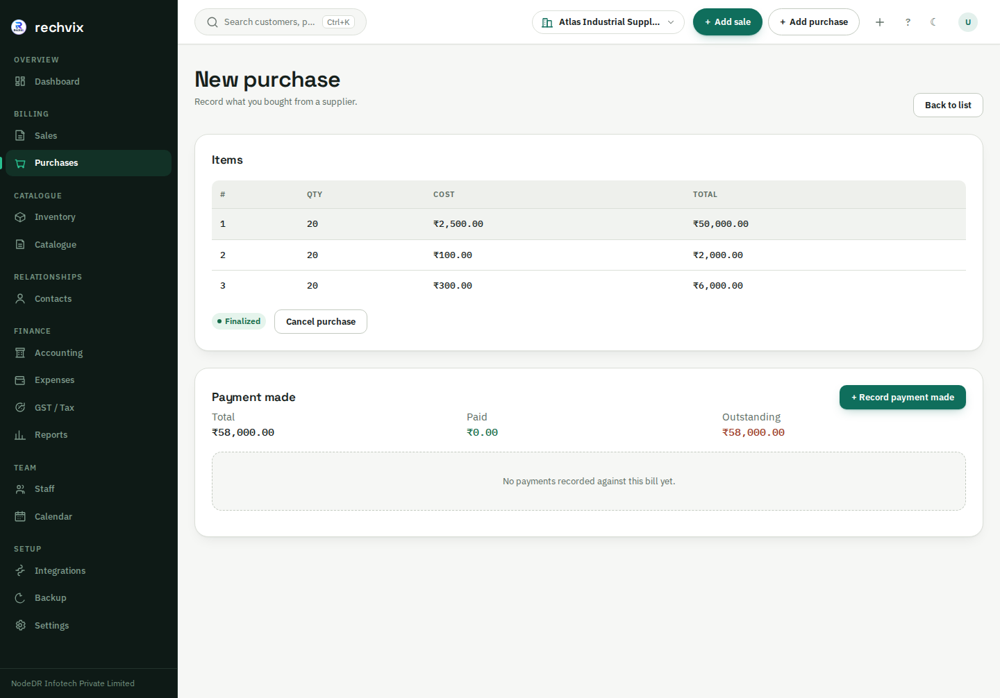

Use **+ Record payment made** to allocate a payment to this supplier bill, choose amount/method/reference and save. Confirm the remaining outstanding amount. Use **Cancel purchase** only when appropriate and review its stock/accounting effects.

## 10. Expenses

### Expenses — `/expenses`

Choose the expense category, payment source, amount and date. Add a useful note, particularly for a catch-all category. Attach the supporting receipt if available and select **Record expense**. Check the recent-expenses list and totals afterward. If the expense saves but its attachment fails, retry the attachment rather than duplicating the expense.

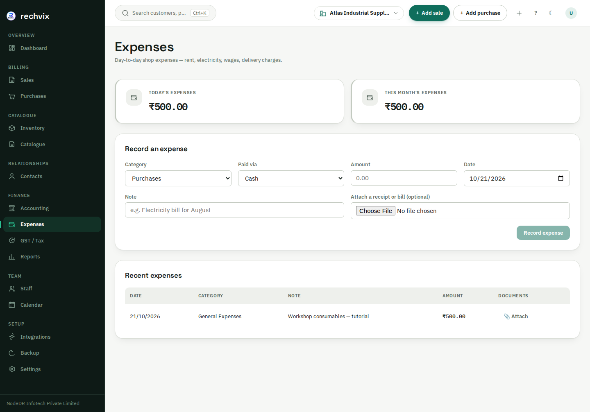

Use Purchases for supplier goods/invoices and Expenses for the supported day-to-day expense workflow. Do not assume an expense entry automatically establishes input-tax deductibility in the accountant package.

## 11. Accounting and fiscal periods

### Accounting — `/accounting`

Review the trial balance, receivables, payables and chart of accounts. Use the export controls next to the relevant report when you need CSV, Excel or PDF. Debit/credit totals should reconcile; inspect source transactions with your accountant if they do not.

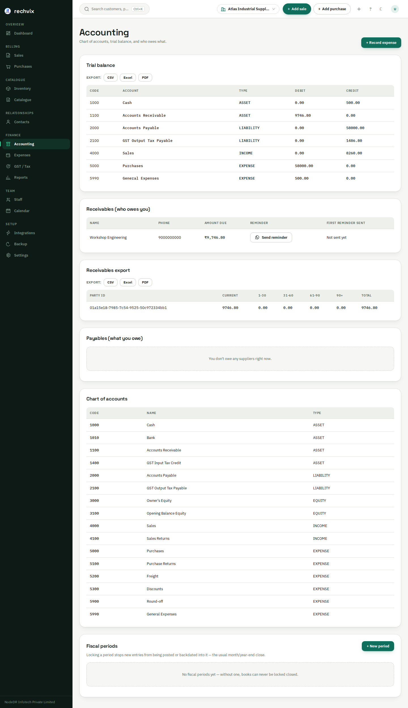

Under **Fiscal periods**, select **+ New period**, enter the label and date range, and save. Lock a period only after reconciliation and accountant approval. A locked period restricts supported posting actions; it is not a replacement for keeping backups and audit evidence. Review an unlock carefully before changing closed books.

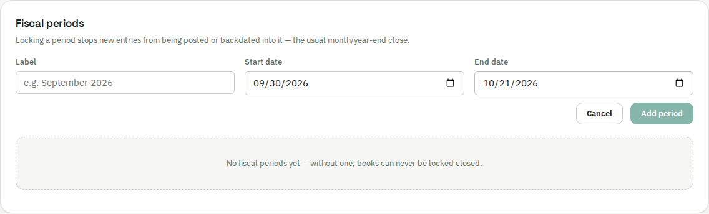

## 12. Tax and files for your accountant

### India GST / Tax — `/gst`

India shows tax-rate management, e-Way Bill mode/threshold, e-Invoice provider settings, bulk e-Way Bill preparation, vehicles, transporters and GST summaries. Confirm the issuing business state and HSN rates before finalizing invoices.

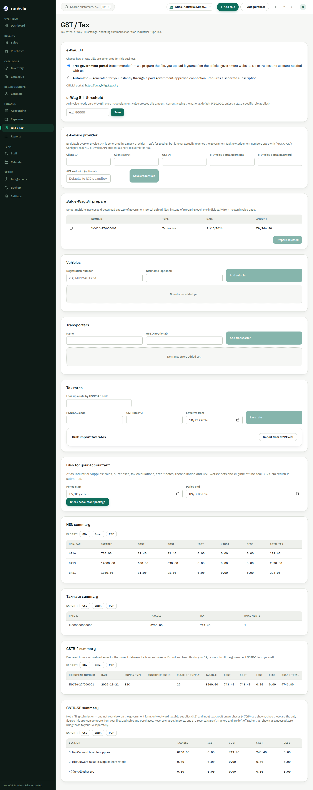

The **free government portal** workflow prepares information for the official portal; follow its steps and record the actual portal result where required. The automatic API path requires the relevant real provider configuration. Mock/sandbox outputs must not be treated as legally issued live government documents. Return filing is separate from these invoice/transport integrations.

### Download an accountant package

1. Check the selected company and its tax identifier/book currency.
2. Find **Files for your accountant** on Tax / GST.
3. Enter the start and end dates. The verified mapping year in this version is **2026**. Choose a full filing period appropriate to your registration; Indian native CSVs require a full calendar month or quarter.
4. Select **Check accountant package**.
5. Read the status and **Review checks**. Expand **Calculated filing worksheet**.
6. Select **Download CA package** for ZIP, or **Workbook only** for XLSX. Changing dates clears the previous download controls; run the check again.
7. Give the complete package and supporting invoices to your accountant. Explain any unresolved issues rather than removing them from the files.

The ZIP contains the workbook, source document/tax registers, exact-decimal source JSON, review checklist, README and file-hash manifest. The workbook distinguishes calculated amounts, editable accountant inputs and final formulas. **Blank statutory inputs mean unknown, not zero.** Recorded purchase tax is a candidate until eligibility is checked.

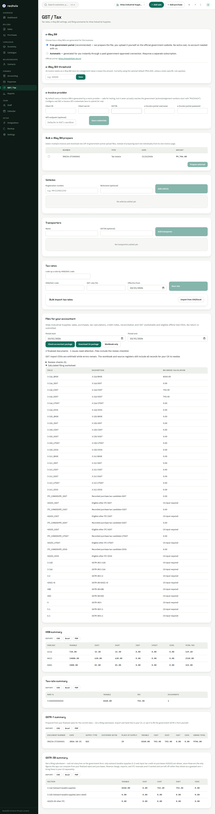

For India, eligible GSTR-1 offline-tool CSVs are included only when required checks pass. Any ERROR withholds all native import CSVs together; source workpapers remain available for correction. The CA must validate files with the current GST utility, complete other sections and perform ITC/GSTR-2B checks. Rechvix does not generate a universally complete portal-ready return.

### Spain: IVA and Modelo 303 workpapers

With a Spanish company selected, `/gst` shows the general Tax page. The package separates ordinary IVA by rate, recargo, credit-note/base corrections, and purchase-tax candidates. The accountant completes deduction eligibility, acquisitions/imports, prorrata, carry-forwards and settlement inputs before filing. These are Modelo 303 workpapers, not an AEAT upload file.

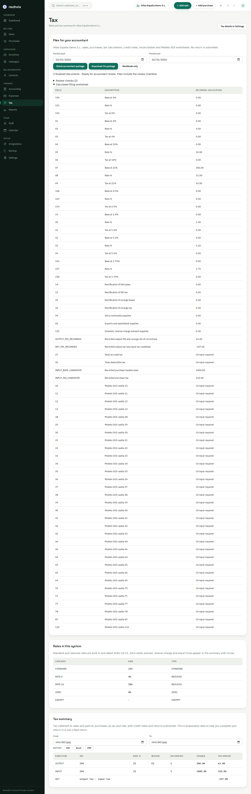

### UK: VAT return workpapers

The UK package provides the nine-box worksheet and recorded output/input candidates and sales/purchases. Northern Ireland fields and other unresolved adjustments require explicit accountant input. Workbook formulas derive Box 3 and the absolute Box 5 amount, with payment/reclaim direction separately identified. The accountant uses appropriate MTD software/digital links for filing.

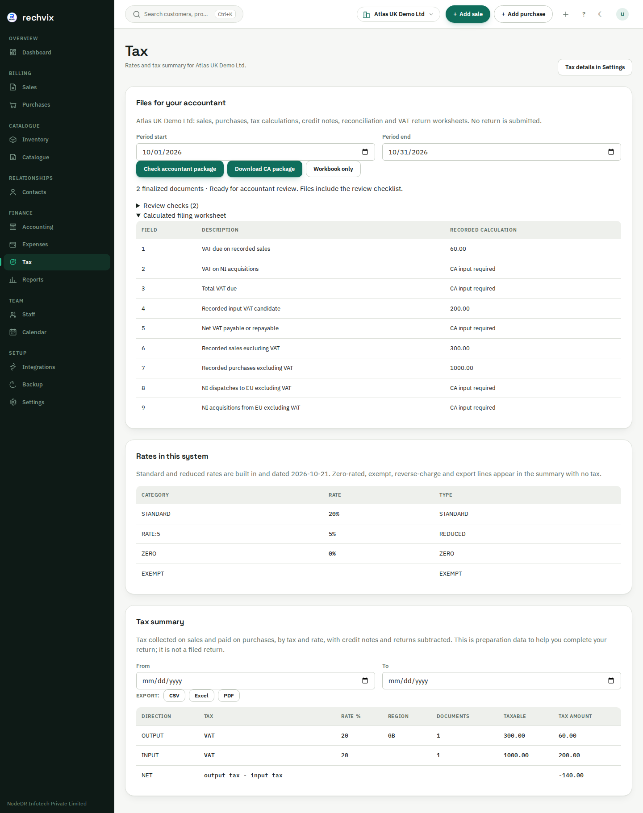

### US: separate state schedules

US packages separate recorded sales and state base tax by state, including configured collection states with no net recorded activity. The CA must resolve local/district tax, nexus, use tax, exemptions, marketplace treatment and the state-specific return. A state base schedule alone is not a complete US filing file. The unresolved warning is expected until those matters are handled externally.

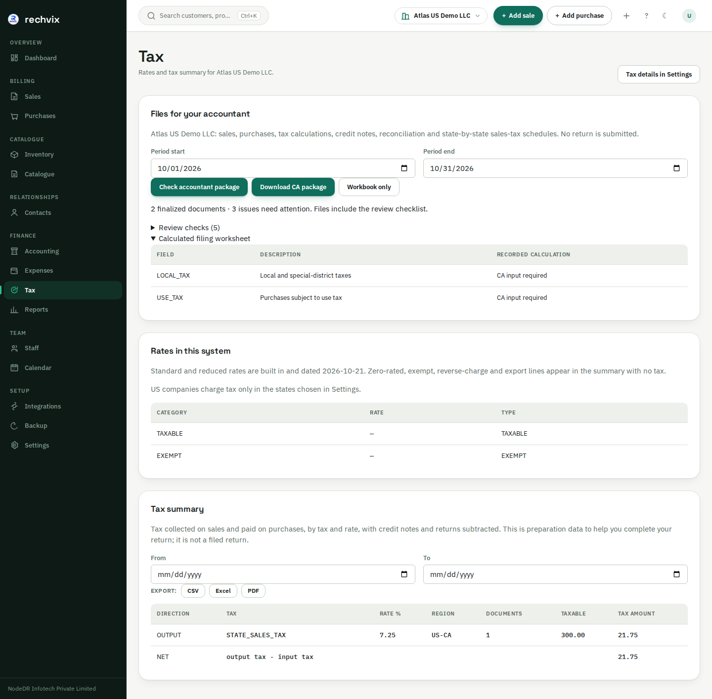

**No government API permission is needed to download these accountant exports.** This does not remove statutory invoicing obligations, grant filing authorization, replace the separate VERI*FACTU record chain (see docs/verifactu.md; it is not certified), or make Rechvix an MTD submission service. These packages cover supported VAT/GST/sales-tax preparation, not every corporate, payroll or personal income tax return. See [the detailed export scope](docs/accountant-exports.md).

## 13. Reports

### Reports — `/reports`

Review sales invoices, gross profit, purchases, stock movement, trial balance, receivables and payables. The page defaults to its documented recent period; check report-specific dates and filters when available. Use each report's own CSV/Excel/PDF export control.

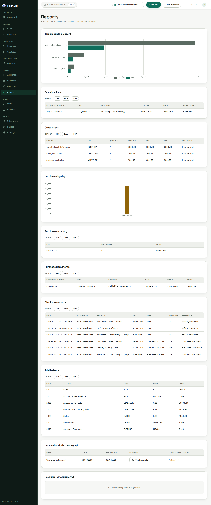

Gross profit uses recorded cost information and should be reviewed alongside stock/cost completeness. In this version, some accounting reports are organisation-wide even when sales/purchase panels are company-filtered. Do not compare differently scoped periods or companies as if they were identical.

## 14. Staff and calendar

### Staff — `/staff`

Enter the member's name, phone and role title, then **Add staff member**. The summary shows attendance counts. A staff record is not automatically a sign-in account; create logins separately in Settings → Team.

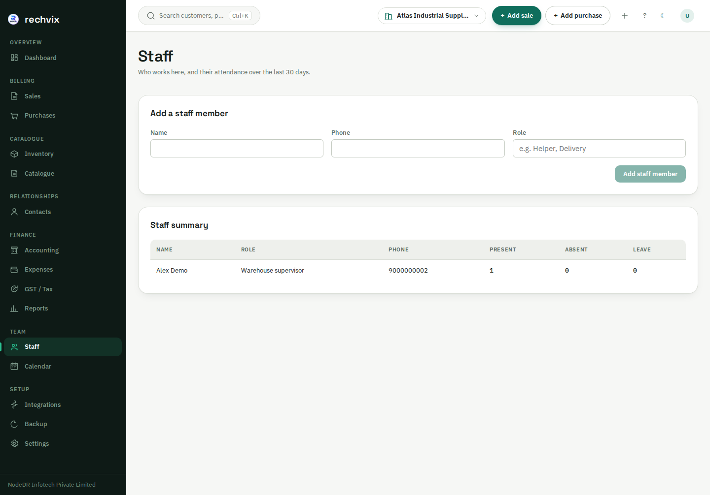

### Calendar — `/calendar`

Move between months with the arrows or **Today**. Select a day to view tasks and attendance. Mark each staff member **Present**, **Absent** or **Leave**. Review the selected date before saving so the entry is recorded on the correct day.

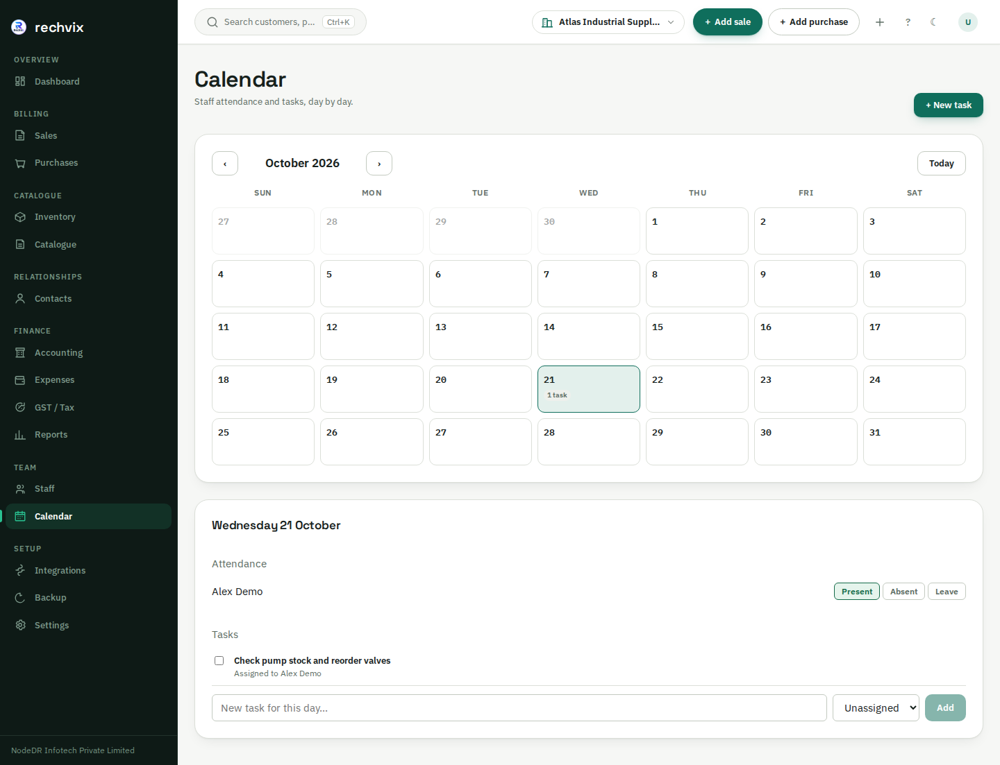

Choose **+ New task**, enter its title, due date and optional assignee, and add it. Mark a task complete when finished; change its status back if correction is needed.

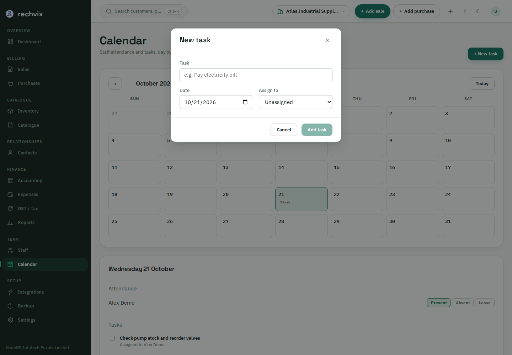

## 15. Integrations

### Integrations — `/integrations`

This page contains WhatsApp sharing information, API keys and webhooks. Core billing does not require these external integrations.

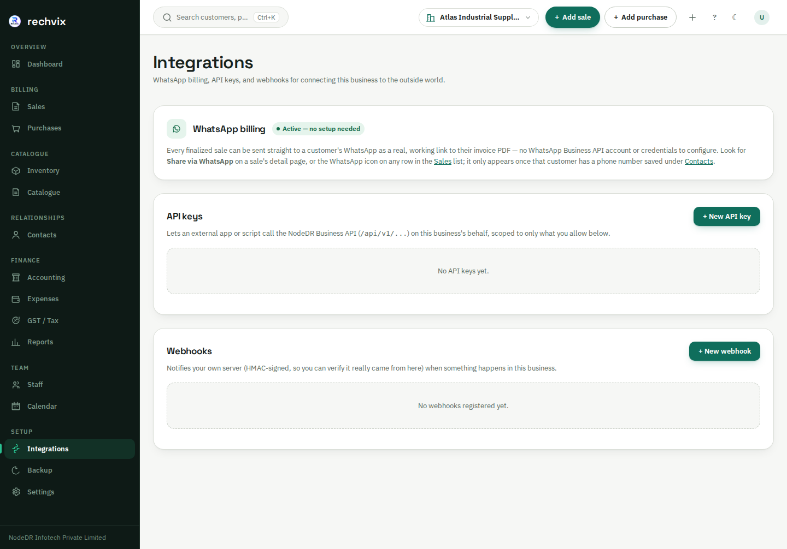

For an API key, select **+ New API key**, enter a recognizable name, choose an expiry if needed and only the required scopes. Create it, save the displayed secret securely and revoke it when no longer needed. Never put a real key in a tutorial, screenshot or support message. These screenshots show the empty creation form only.

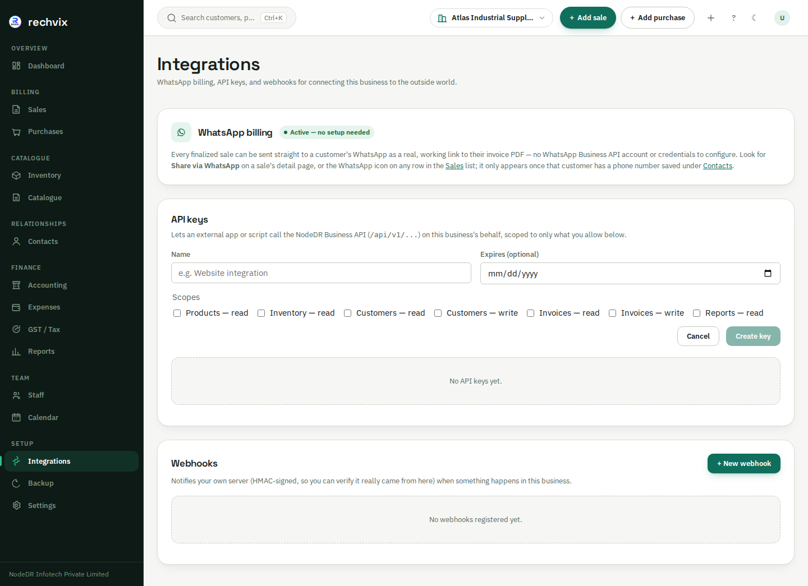

For a webhook, choose **+ New webhook**, enter the intended HTTPS endpoint and select events. Register it only after you control the destination and have checked the receiving service. Do not use the example address as a real destination.

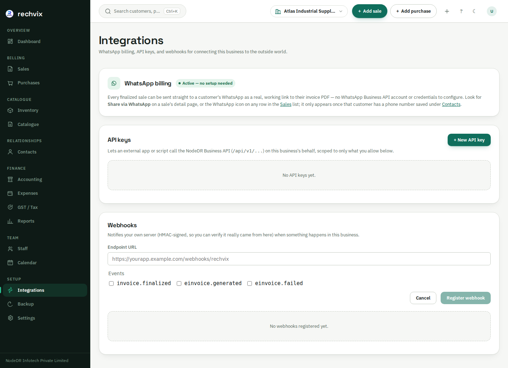

## 16. Backup and restore

### Backup & Restore — `/backup`

**Export a backup** downloads an encrypted `.nodedrbackup` file. Store backups securely away from the app's own disk and retain the encryption secrets needed for recovery. On CasaOS, back up the database and `/DATA/AppData/rechvix/secrets` together as described in the deployment guide. An operator must configure backup support; an unconfigured installation shows an explanatory message instead of working controls.

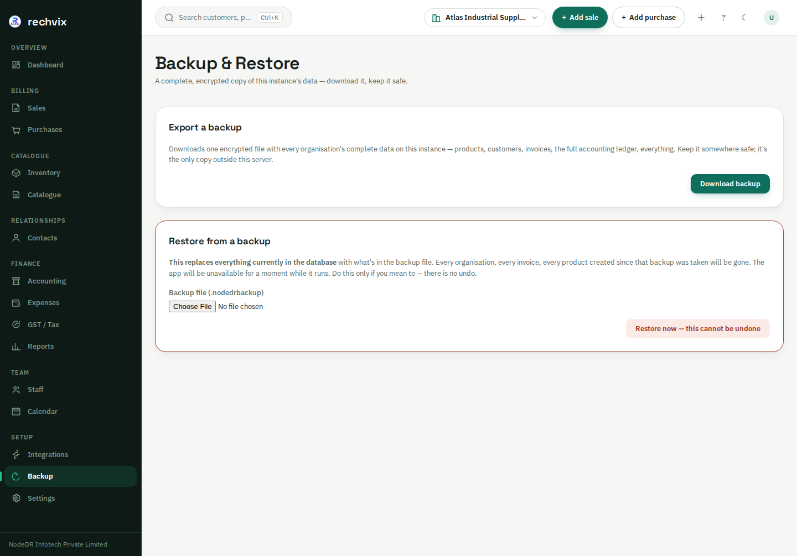

**Restore from a backup replaces the entire instance database, including every organisation.** Schedule downtime and make a current backup first. Select the intended backup, inspect its metadata, then type **RESTORE** only when you intend that replacement. Afterward, sign in and verify records. No restore was performed to produce this tutorial. See [deployment and recovery instructions](docs/operations/deployment.md) for operator prerequisites and recovery testing.

## 17. Using a phone

Open the same app URL in a mobile browser and sign in. The bottom navigation scrolls horizontally: swipe it sideways to reach destinations beyond the initially visible ones. The top bar keeps compact search, company, creation and account controls. Long pages scroll vertically; wide data tables may have their own horizontal scrolling region.

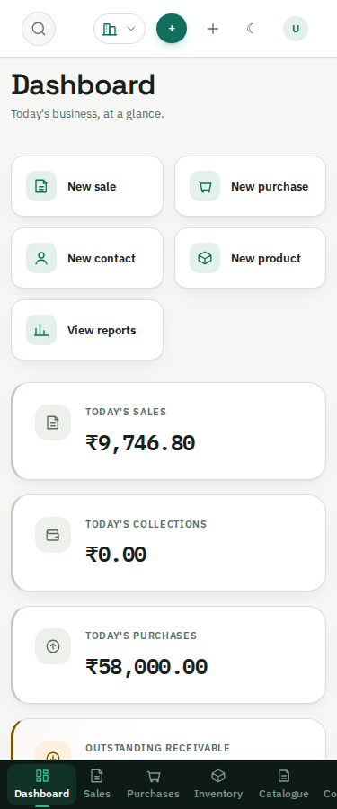

The invoice controls stack on a phone. Choose or create the customer, start the sale, add items and review quantities/totals before finalizing. Scroll down to the totals/actions; they may not fit in the first screen.

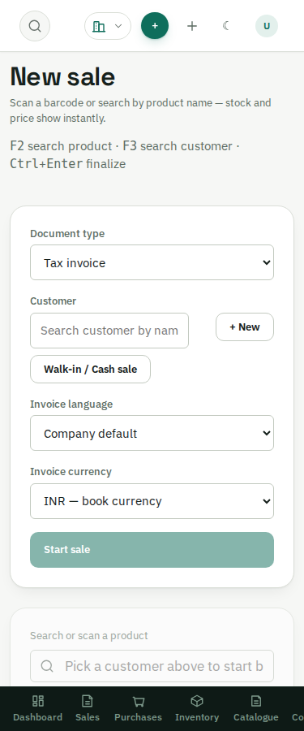

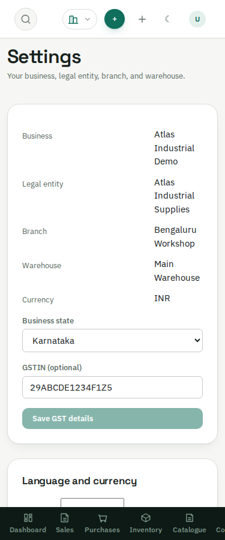

For printing or accountant handoff on a phone, use the device's download/share capabilities and check where the file was saved. A desktop is usually easier for reviewing large workbooks and multi-column registers.

## 18. Daily checklist and troubleshooting

### Suggested daily routine

1. Confirm company and warehouse, then review dashboard balances.
2. Record supplier purchases and verify stock receipts.
3. Create/finalize sales and record payments against the appropriate invoice.
4. Record expenses and attach receipts.
5. Review stock exceptions, outstanding balances and the day's tasks.
6. At period end, reconcile and send the accountant package with its checks and supporting documents.
7. Keep verified backups and have the accountant approve period locking.

### When something does not work

| Symptom | What to check |
|---|---|
| Invoice cannot finalize | Read the displayed validation error; check customer, tax category/rate, GST state, stock and exchange rate. Fix the draft before retrying. |
| Product adds at zero price | Set its selling price in Catalogue and verify the invoice line. Do not finalize an unintended free sale. |
| Missing stock or wrong balance | Check selected company/warehouse, finalized purchases and movement history; do not adjust the same difference twice. |
| Tax package has errors | Open Review checks, correct source records where appropriate and regenerate. Send unresolved source evidence to the CA. |
| Unknown tax field is blank | The CA must determine it. Enter zero only after verifying that zero applies. |
| Can't see a company or download a report | Ask the administrator to review company access and report view/export permissions. |
| Backup page has no controls | Ask the operator to configure backup support; do not change credentials blindly. |
| Password link fails | Request a current reset link and open the complete URL with its token; check configured delivery with the operator. |
| Phone navigation seems incomplete | Swipe the bottom navigation sideways and scroll the page/table as appropriate. |
| Government document shows mock/not generated | It is not evidence of live issuance. Check provider mode and use the documented live/portal workflow when legally required. |

## 19. Page and screenshot coverage

All **22 concrete application route patterns** in `apps/web/src/router.tsx` were opened in the running app. The wildcard route redirects to Dashboard and has no independent page. Purchase details, product editing and several forms share their parent route and are captured separately. Screenshots of external government portals or the browser's native file/print dialogs are not application pages.

| Page / route | Screenshot |
|---|---|
| Sign in `/login` | [01](docs/assets/tutorial/01-login.png) |
| First-run setup `/setup` | [02](docs/assets/tutorial/02-setup.png) |
| Forgot password `/forgot-password` | [03](docs/assets/tutorial/03-forgot-password.png) |
| Reset password `/reset-password` | [04](docs/assets/tutorial/04-reset-password.png) |
| Dashboard `/` | [05](docs/assets/tutorial/05-dashboard.png) |
| Sales `/sales` | [06](docs/assets/tutorial/06-sales.png) |
| New/resumed sale `/sales/new` | [07](docs/assets/tutorial/07-new-invoice.png), [24](docs/assets/tutorial/24-invoice-builder-filled.png) |
| Sale details `/sales/:id` | [08](docs/assets/tutorial/08-invoice-detail.png) |
| Purchases `/purchases` | [09](docs/assets/tutorial/09-purchases.png), [detail 30](docs/assets/tutorial/30-purchase-detail.png) |
| Inventory `/inventory` | [10](docs/assets/tutorial/10-inventory.png), [selected product 31](docs/assets/tutorial/31-stock-movements.png) |
| Catalogue `/catalogue` | [11](docs/assets/tutorial/11-catalogue.png), [new 32](docs/assets/tutorial/32-new-product.png), [edit 33](docs/assets/tutorial/33-edit-product.png) |
| Contacts `/contacts` | [12](docs/assets/tutorial/12-contacts.png), [new 34](docs/assets/tutorial/34-new-contact.png) |
| Contact details `/contacts/:id` | [13](docs/assets/tutorial/13-contact-detail.png) |
| Accounting `/accounting` | [14](docs/assets/tutorial/14-accounting.png), [period 35](docs/assets/tutorial/35-fiscal-period.png) |
| Expenses `/expenses` | [15](docs/assets/tutorial/15-expenses.png) |
| GST / Tax `/gst` | [India 16](docs/assets/tutorial/16-india-tax.png), [India export 42](docs/assets/tutorial/42-india-accountant-export.png), [Spain 43](docs/assets/tutorial/43-spain-tax.png), [UK 47](docs/assets/tutorial/47-uk-tax.png), [US 48](docs/assets/tutorial/48-us-tax.png) |
| Reports `/reports` | [17](docs/assets/tutorial/17-reports.png) |
| Staff `/staff` | [18](docs/assets/tutorial/18-staff.png) |
| Calendar `/calendar` | [19](docs/assets/tutorial/19-calendar.png), [task 36](docs/assets/tutorial/36-calendar-task.png) |
| Integrations `/integrations` | [20](docs/assets/tutorial/20-integrations.png), [key 37](docs/assets/tutorial/37-api-key.png), [webhook 38](docs/assets/tutorial/38-webhook.png) |
| Backup `/backup` | [21](docs/assets/tutorial/21-backup.png) |
| Settings `/settings` | [22](docs/assets/tutorial/22-settings.png), [team 39](docs/assets/tutorial/39-team-member.png), [bank 40](docs/assets/tutorial/40-bank-account.png), [branch 41](docs/assets/tutorial/41-branch.png) |

Additional screenshots document inline customer creation, invoice-linked payments, returns, print controls, Hindi print output and phone layouts. Screen capture does not imply every destructive or external workflow was executed: no production deployment, government filing, customer message, real API credential or database restore was performed. Spain, UK and US accountant ZIP downloads were exercised against the local demo server.
